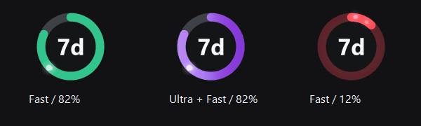

# Codex Usage Rings

适用于 Windows Codex 桌面端的本地用量圆环插件与伴随程序。在头像上方显示 `7d` / `5h` 剩余额度，自动定位并对齐。



## 功能

- 圆周表示剩余额度：大于 15% 为绿色，小于等于 15% 为红色。
- 未返回有效 5h 额度时隐藏该圆环；7d 未知时显示灰色虚线。
- 所有模型的 Ultra 思考强度显示官方风格紫白流动渐变；1.5x Fast 开启时叠加粒子。
- Windows 原生子窗口随 Codex 移动；悬停显示剩余比例、重置时间及采样时间。
- 每 60 秒读取额度，支持托盘刷新和当前用户登录自启。

## 安装和启动

1. 从本仓库 Releases 下载 `Codex-Usage-Rings-0.4.9.zip` 并完整解压到固定目录。
2. 运行 `codex-usage-rings/Start.cmd`。停止时运行 `Stop.cmd`，或从托盘菜单退出。
3. 在 Codex 中展开模型菜单约 2 秒，让程序读取 Fast 开关。随后可关闭菜单；每次重启伴随程序后需重新读取一次。

需要登录自启时，在 PowerShell 中运行：

```powershell
.\codex-usage-rings\AutoStart.ps1
```

取消登录自启：

```powershell
.\codex-usage-rings\AutoStart.ps1 -Remove
```

可选的 Codex 插件注册（需要可用的 `codex` 命令）：

```powershell
.\Register-plugin.ps1
codex plugin add codex-usage-rings@local-usage-rings
```

## 升级已有安装

先运行旧目录的 `codex-usage-rings/Stop.cmd`，再将新安装包完整解压覆盖到原固定目录，然后运行 `Start.cmd`。若改用新目录且以前设置过登录自启，请先在新目录运行 `AutoStart.ps1` 更新任务路径，再启动，避免旧任务继续运行旧版。

## 从源码构建

Windows x64，使用系统 .NET Framework 4.x 自带 C# 编译器，不需下载构建依赖。

```powershell
.\codex-usage-rings\Build.ps1
.\codex-usage-rings\Test.ps1
.\codex-usage-rings\Test-Native.ps1
.\codex-usage-rings\Test-Hover.ps1
.\codex-usage-rings\Test-Reset.ps1
```

源码仓库不包含编译产物；`Start.cmd` 会在程序缺失时尝试构建。Release 安装包包含预编译程序。

## 原理与适用范围

额度通过本机 Codex app-server 的 `account/rateLimits/read` 读取，按周期长度区分 7d 与 5h；程序不读取或保存账户凭据。窗口与模式识别使用 Windows UI Automation。

这是独立社区工具，采用原生子窗口附着，不是官方提供的头像区域嵌入接口，也不修改 Codex 安装文件。客户端辅助功能结构变化可能需要适配；当前验证宿主为 OpenAI.Codex 26.1013.4894.0。Ultra 与 Fast 动效参考该版本的本地界面效果，并针对圆环改编。

Codex 窗口可见且定位可靠时显示；切换到其他应用不隐藏圆环，最小化或隐藏宿主时隐藏。多显示器位置和 DPI 已进行计算测试，实际多显示器切换未逐项人工验证。

## 诊断

运行 `codex-usage-rings/Status.ps1`。状态文件位于 `%LOCALAPPDATA%/CodexUsageRings/status.json`，包含定位、模式识别、绘制与悬停诊断。

v0.4.9 验证：319 项常规检查、64,000 帧渲染、135 项悬停检查；原生窗口移动、重连、后台显示、最小化与恢复测试通过；用户实机确认切换应用和切回均正常。

当前源码包含后台 Fast 刷新、切换思考强度时保留 Fast 状态，以及手动重置卡面板；Release 安装包为 v0.4.9。

## 重置卡

点击 7d 或有效的 5h 圆环打开卡片列表，展示卡片名称与到期时间；右上角可刷新。每张可用卡片右侧有“重置”按钮。

- 第一次点击“重置”变为“确认”；第二次点击必须严格晚于第一次 0.5 秒且早于 10 秒，才提交所选卡片的重置请求。
- 关闭面板、切换卡片、超时或宿主失去前台焦点会取消确认；处理期间禁止重复提交。
- 只使用明确选中的卡片 ID；操作前再次核对账户、卡片状态和有效期。请求结果不确定时不会自动重试，再次手动操作同一卡片会复用本次进程中的请求标识。
- 操作完成后重新读取卡片和额度；“无可重置周期”等响应会明确显示，不会伪报成功。
- 卡片详情不可用时不会根据数量虚构卡片；不提供购买入口。

开发验证：32 项重置卡/确认/请求校验检查，35 项原生面板检查（模拟服务），真实账户只读查询。未使用真实重置卡测试提交效果。

协议依据：[OpenAI App Server](https://learn.chatgpt.com/docs/app-server#8-earned-rate-limit-resets-chatgpt)。
面板启动后预读取卡片，60 秒内重新打开使用缓存；过期后后台刷新。重置前仍执行实时账户与卡片校验。

重置成功且服务器确认额度增加后，圆环平滑回填、绿色粒子沿圆周切线向末端汇聚；实际回满后轻微白闪。动画使用真实前后额度，仅改变绘制过程。新增 65 项回填检查及模拟重置触发验证。
